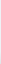

# suite/graphic

Elementi grafici neutri delle email della suite, uguali per tutti i marchi (nessun nome né logo).

| File | Uso |
|---|---|
| `thead.png` | Sfumatura delle intestazioni delle tabelle di listing (3 novembre 2026): 1 × 64 px, `#EEF1F5` in alto e, negli ultimi 27 px, la sfumatura della GIF dell'autore (`gray_sfuma_header.gif`) fino a `#E1E3E6`. Si usa come `background:#EEF1F5 url(.../thead.png) 0 100%` sulle celle `<th>`, ancorata in basso; Outlook desktop mostra il colore pieno (`bgcolor`). Peso 101 byte. |

